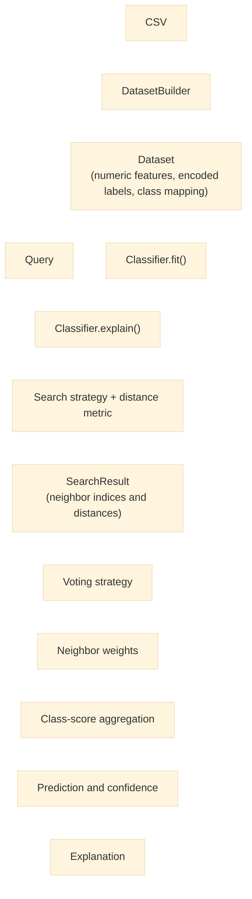

# Kinlens

<div align="center">


[](https://github.com/BasharMithan/Kinlens)
[](https://github.com/BasharMithan/Kinlens/commits/main)
[](https://github.com/BasharMithan/Kinlens/actions/workflows/tests.yml)

Kinlens is an educational Python project for exploring an explainable
K-nearest-neighbors (KNN) classifier. It currently loads labeled data from CSV,
searches for neighbors, weights their votes, predicts a class, and returns the
evidence used for a prediction.

</div>

## Architecture

Kinlens separates data preparation, neighbor search, distance calculation,
voting, and classification so each part can be understood and extended
independently.



### Main components

- **Data:** [`DatasetBuilder`](src/kinlens/utils/dataset.py) reads CSV data,
  converts selected feature columns to numeric arrays, and encodes target
  labels. [`Dataset`](src/kinlens/datasets.py) holds the features, encoded
  labels, class names, and label mapping.
- **Search:** [`Search`](src/kinlens/abstraction/search.py) defines the
  searcher interface. The current [`BruteForseSearch`](src/kinlens/search.py)
  calculates distances to every training row and returns the nearest `k`
  indices and distances in a `SearchResult`.
- **Metrics:** [`DistanceMetric`](src/kinlens/abstraction/metric.py) defines
  the distance interface. The built-in choices are Euclidean, Manhattan, and
  cosine distance.
- **Voting:** [`Voting`](src/kinlens/abstraction/voting.py) defines the voting
  interface. The built-in strategies are uniform and inverse-distance voting;
  each returns a weight for every neighbor.
- **Classification:** [`Classifier`](src/kinlens/classifier.py) coordinates
  search and voting, sums weights by encoded class, selects the highest-scoring
  class, and calculates confidence as that class's score divided by the sum of
  all class scores.
- **Explanation:** [`Explanation`](src/kinlens/models/explaination.py) records
  the prediction and its evidence: query, neighbor indices and labels,
  distances, weights, per-class score totals, and confidence. `predict()` maps
  the encoded prediction back to the original target label.
- **Validation and result models:** `validation/` checks dataset, query, and
  search inputs; `models/` defines the data structures passed between
  components.

The classifier currently defaults to Euclidean distance, brute-force search,
and inverse-distance voting. The interfaces make alternative metrics, voting
strategies, and search implementations possible, but only the listed built-in
options are currently provided. Kinlens does not currently include
`predict_proba`, feature scaling, train/test evaluation utilities, or
counterfactual explanations. Confidence is a vote-share score, not a
calibrated probability.

## Clone and install

Kinlens requires Python 3.14 or newer and [uv](https://docs.astral.sh/uv/).
Clone the repository, enter the project directory, and install the project with
its development dependencies:

```bash
git clone https://github.com/BasharMithan/Kinlens.git
cd Kinlens
uv sync --group dev
```

## Quick start

```python
from pathlib import Path

import numpy as np

from kinlens.classifier import Classifier
from kinlens.utils.dataset import DatasetBuilder

dataset = DatasetBuilder(
    path=Path("data.csv"),
    features=["feature_1", "feature_2"],
    label="target",
).build()

classifier = Classifier(k=5)
classifier.fit(dataset)

query = np.array([0.2, 0.1])
explanation = classifier.explain(query)

print("Predicted class:", classifier.predict(query))
print("Neighbor indices:", explanation.indices)
print("Neighbor distances:", explanation.distances)
print("Vote totals by class:", explanation.classScore)
print("Confidence:", explanation.confidence)
```

`Classifier` defaults to Euclidean distance and inverse-distance voting. Pass a
different metric or voting strategy to the constructor to change those
behaviors. `classifier.predict(query)` returns the original target label;
`classifier.explain(query)` returns an `Explanation` with the encoded
prediction and the evidence behind it.

## Benchmark

Kinlens was compared with scikit-learn's `KNeighborsClassifier` on the
Social Network Ads dataset using `k=3`, Euclidean distance, and an identical
75/25 stratified train/test split. Kinlens used inverse-distance voting and
scikit-learn used distance weighting.

| Metric | scikit-learn KNN | Kinlens KNN |
|---|---:|---:|
| Accuracy | 75.00% | 75.00% |
| F1 | 60.32% | 60.32% |
| Recall | 52.78% | 52.78% |

Both implementations agreed on all 100 test predictions (100% prediction
agreement). The reproducible benchmark and neighbor examples are available in
[`kinlens-performace.ipynb`](src/kinlens/notebooks/kinlens-performace.ipynb).

## Development

Run the test suite with:

```bash
uv run pytest
```

The notebooks in [`src/kinlens/notebooks/`](src/kinlens/notebooks/) contain
explorations and examples of the current implementation.
